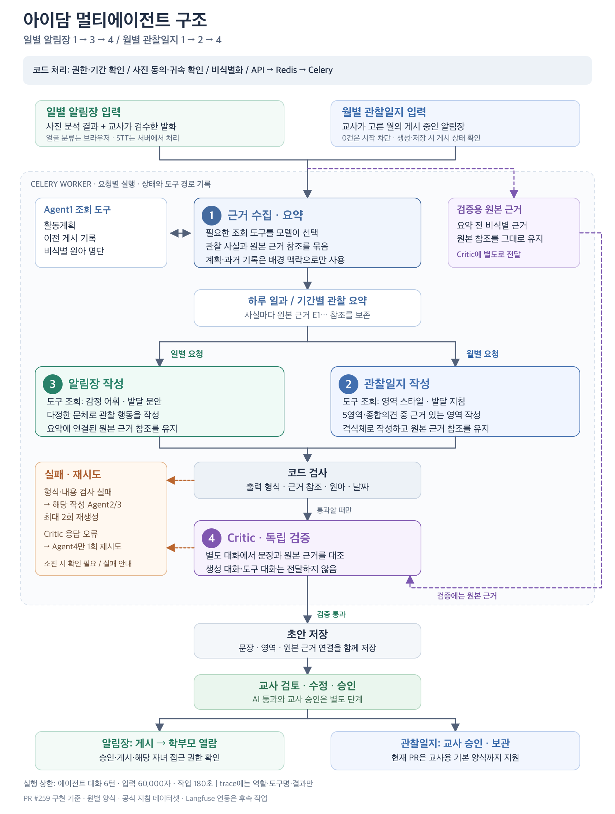

# 아이담

> 영상·사진·음성 속 맥락을 모아 원아의 하루를 담아내는 **AI 알림장·관찰일지 자동 작성 서비스**

카카오테크 캠퍼스 4기 2단계 팀 프로젝트 — 충남대 4팀

| 바로가기 | |
|---|---|
| 배포 서비스 | https://d4kl98c6dogl6.cloudfront.net |
| 기술문서(테크스펙) | [docs/테크스펙.md](docs/테크스펙.md) |
| API 문서 | [docs/api/](docs/api/README.md) |
| 시연 영상 · 발표 자료 | (링크 추가 예정) |

## 어떤 문제를 푸나요

타겟은 국공립 어린이집 담임교사(만 3세반, 원아 6명 담당)입니다. 하루에 사진·영상을 100~150장 찍고, 관찰은 낮에 이미 끝납니다. 그런데 그것을 알림장과 관찰일지로 옮기는 데 퇴근 후 1~2시간이 더 듭니다. 병목은 사진 개수가 아니라, 촬영 순간의 맥락이 퇴근 무렵 휘발된다는 점입니다.

아이담은 오늘 찍은 것을 올리면 **누가 무엇을 했는지** 찾아 초안을 만들고, 교사는 **검토·승인만** 합니다. 목표는 검토 시간 15~20분, 수정 없이 승인하는 비율 60% 이상입니다. 초안의 문장마다 근거(원문 발화·사진)를 붙여 믿고 확인할 수 있게 합니다.

## 사용 흐름

1. **얼굴 등록(최초 1회)** — 원아 얼굴 특징을 브라우저에서 추출해 등록합니다.
2. **촬영분 업로드** — 오늘 찍은 사진·영상·음성을 올립니다.
3. **AI 처리** — 얼굴 인식, 음성 인식, 근거 수집, 초안 작성, 검증이 단계별로 진행되고 화면에 실시간으로 표시됩니다.
4. **모호한 근거 확인** — 누구인지 불분명한 사진만 골라 교사에게 묻습니다.
5. **초안 검토·수정·승인** — 문장별 근거와 함께 보고 고칩니다.
6. **공개** — 승인된 알림장만 학부모에게 보이고, 관찰일지는 월별로 모아 저장됩니다.

## 에이전트 구조



- **일별 알림장:** 근거 수집 에이전트가 하루치 근거를 요약하고, 작성 에이전트가 그 요약과 비식별 원문으로 초안을 씁니다.
- **월별 관찰일지:** 같은 방식으로 게시된 알림장을 모아 관찰일지를 씁니다.
- **검증 에이전트:** 생성 대화를 공유하지 않고 원본 비식별 근거만으로 초안을 독립 검증합니다. 통과하지 못하면 해당 단계로 돌아가 다시 쓰고, 재시도 상한을 넘으면 교사에게 확인 필요나 실패 사유를 안내합니다.
- 에이전트는 네이티브 도구 호출로 얼굴 매칭·근거 조회 같은 도구를 스스로 골라 씁니다. 모델이 임의의 도구·ID·URL을 부르면 거부합니다.

자세한 검증 방법은 [docs/multi-agent-validation.md](docs/multi-agent-validation.md)에 있습니다.

## 개인정보와 안전 장치

원아 사진을 다루는 서비스라서 아래 네 가지를 어기면 머지하지 않는 규칙으로 두었습니다.

- **승인 전에는 공개하지 않습니다.** 학부모 공개와 외부 전송은 교사 승인과 접근 권한 검사를 통과해야 하고, 공개 경로는 단일 게이트 함수 하나로 모았습니다.
- **외부 LLM에 개인정보를 보내지 않습니다.** 실명은 `CHILD_A` 같은 토큰으로 바꿔 보내고, 답이 돌아오면 되돌립니다. 이름을 부르는 호칭과 깨진 토큰도 걸러냅니다. 동의하지 않은 원아가 찍힌 사진은 LLM 입력에서 제외합니다.
- **얼굴 검출·임베딩은 브라우저에서만 합니다.** HUMAN(`@vladmandic/human`)으로 계산하고, 등록용 원본 사진은 서버나 S3로 보내지 않습니다. 벡터만 추출한 뒤 폐기합니다.
- **열람과 파기는 기록합니다.** 열람은 `AccessLog`, 파기는 `DeletionLog`에 남기고, 로그에는 실명·연락처·토큰·임베딩 값을 찍지 않습니다.

## 기술 스택

| 영역 | 사용 기술 |
|---|---|
| 프론트엔드 | React, TypeScript, Vite, React Router, TanStack Query, Zustand, Tailwind, shadcn/ui |
| 온디바이스 AI | HUMAN (BlazeFace 검출 → FaceMesh 정렬 → faceres 임베딩) |
| 백엔드 | Python, FastAPI, SQLAlchemy, Alembic, PostgreSQL, Redis, Celery |
| 배포 | S3 + CloudFront(프론트), EC2 + Docker Compose + Caddy(백엔드) |
| CI/CD | GitHub Actions (PR 검사, `develop` 머지 시 자동 배포) |

## 직접 실행하기

저장소 루트에서 백엔드를, `frontend/`에서 프론트엔드를 실행합니다. 자세한 단계는 각 README에 있습니다.

```bash
# 백엔드 (Docker 필요)
python3 backend/scripts/init_env.py   # backend/.env 생성
docker compose up --build -d --wait

# 프론트엔드 (Node 24, pnpm 11)
cd frontend
pnpm install
pnpm dev                              # MSW 목 API로 실행
```

- 백엔드 실행·테스트·배포: [backend/README.md](backend/README.md)
- 프론트엔드 실행·검사·목 데이터: [frontend/README.md](frontend/README.md)
- 프론트엔드 배포 자원: [infra/frontend/README.md](infra/frontend/README.md)
- 환경변수는 키 이름만 `backend/.env.example`에 있고, 실제 값은 저장소에 두지 않습니다.

## 테스트와 CI

- **백엔드:** `pytest`로 API·권한·작업 흐름·에이전트 파이프라인을 검사합니다. `ruff`로 린트와 포맷을 봅니다.
- **프론트엔드:** Vitest로 화면·API·목 데이터를 검사하고 Prettier, ESLint, `tsc`, 빌드를 돌립니다.
- PR마다 [CI](.github/workflows/ci.yml)가 위 검사를 모두 돌리고, 통과해야 머지합니다. `develop`에 머지되면 백엔드는 EC2로, 프론트엔드는 S3로 자동 배포됩니다.

## 문서

| 문서 | 내용 |
|---|---|
| [docs/테크스펙.md](docs/테크스펙.md) | 요구사항, 아키텍처, 데이터 모델, 시나리오, 리스크, 테스트 전략 |
| [docs/api/](docs/api/README.md) | 엔드포인트별 요청·응답 |
| [docs/multi-agent-validation.md](docs/multi-agent-validation.md) | 멀티에이전트 구조와 검증 방법 |
| [docs/ai-data-contract.md](docs/ai-data-contract.md) | AI에 보내는 데이터의 규약 |
| [CLAUDE.md](CLAUDE.md) | 팀 공통 규칙(절대 규칙, 용어, Git) |
| [docs/doc-management.md](docs/doc-management.md) | 문서 관리 원칙 |

## 팀

| 이름 | 역할 |
|---|---|
| 정은 (팀장) | PM · BE, FE |
| 김진하 | PM · FE, AI |
| 김동건 | 평가·QA · BE, FE |
| 이한나 | 평가·QA · BE, FE |
| 한상균 (AI 리드) | 통합 · BE, AI |
| 송유진 (FE 리드) | 통합 · FE, AI |
| 엄태은 (BE 리드) | 발표·스토리 · BE, AI |
