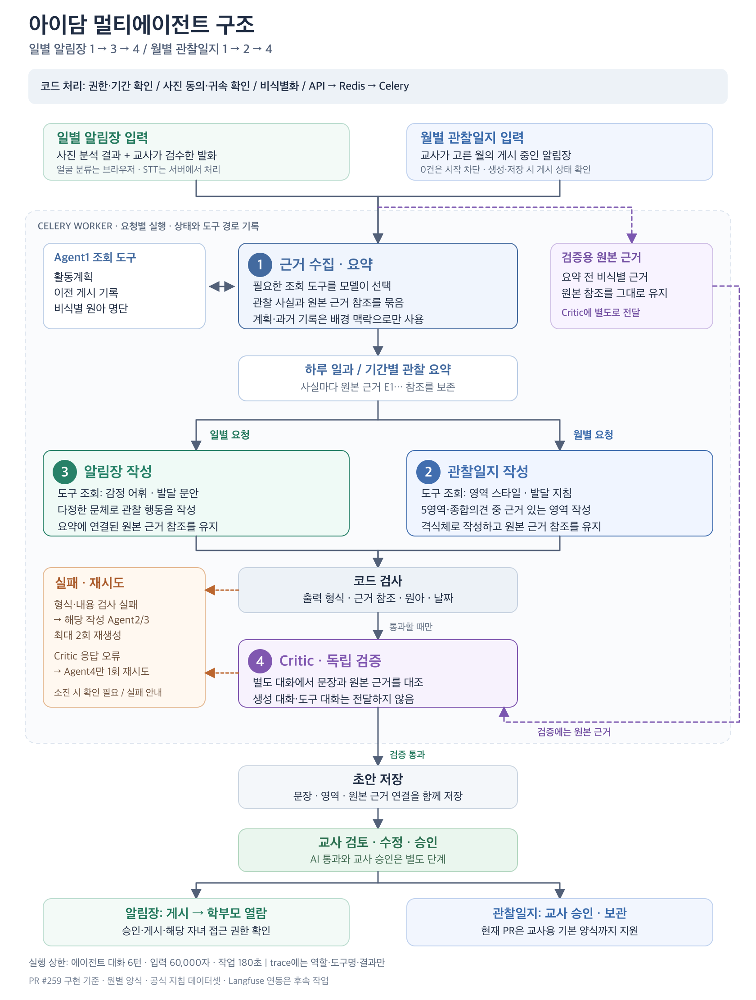

# 멀티에이전트 검증 방법

관련 요구사항: FR-05·FR-06·FR-07·FR-27, H-1~H-4.

## 현재 구현 구조도



[확대 PNG](multi-agent-architecture.png) · [수정 가능한 SVG 원본](multi-agent-architecture.svg)

- 일별 알림장은 Agent1의 요약을 Agent3가 작성하고, 월별 관찰일지는 Agent2가 작성합니다.
- Agent1·2·3은 네이티브 도구 호출을 사용합니다. Agent4는 생성 대화를 공유하지 않고 원본 비식별 근거로 검증합니다.
- 회색 박스는 코드 처리, 번호가 붙은 박스는 AI 역할입니다. 보라색 점선은 원본 근거 전달, 주황색 점선은 실패 처리입니다.
- 코드 검사·Critic 내용 실패는 해당 작성 에이전트로, Critic 응답 형식 오류는 Critic으로 돌아갑니다. 재시도 상한 뒤에는 확인 필요 또는 실패 사유를 안내합니다.
- 이 그림은 PR #259의 구현을 설명합니다. 실행 흐름을 바꾸면 SVG와 PNG를 함께 갱신합니다. 후속 범위는 아래 남은 고도화 절과 테크스펙을 참고합니다.

## 자동 검증

| 검증 | 방법 | 확인하는 것 |
| --- | --- | --- |
| 네이티브 도구 | `tests/agents/test_multi_agent.py`, `test_llm_gateway.py` | 모델이 고른 도구 실행 후 결과 전달, 임의 도구·ID·URL 거부, 필수 도구 누락·반복·입력 상한에서 종료 |
| 사진 알림장 | `tests/agents/test_photo_pipeline.py` | API→근거 요약→도구 조회→작성→Critic→저장→교사 승인/게시→자녀 연결된 학부모 열람. 외부 AI·S3만 고정 응답 |
| 월별 관찰일지 | `tests/agents/test_monthly_pipeline.py` | 게시 알림장 조회→요약→관찰일지 작성→영역/원본 문서 근거 저장→승인, 빈 월·회수본·다른 원아·학부모 권한·중복 요청 차단 |
| 화면 | `ObservationGenerator.test.tsx` 등 Vitest | 자료 0건 차단, 월별 요청과 검토 링크, 실패 안내·재시도 요청 ID 유지 |
| 기존 동작 | 전체 pytest, `pnpm check`, `pnpm build` | 기존 문서·동의·권한·일별 생성과 프론트 회귀 검사 |

저장소 루트 기준:

```bash
cd backend
python -m pytest -q
ruff check .
ruff format --check .
```

```bash
cd frontend
pnpm check
pnpm build
```

## 초기 구현 당시 실제 모델 호출

로컬 worker의 기존 환경설정을 사용해 GLM-5.3-Flash에 합성 관찰 1건을 전송했다.
알림장: collector→감정 어휘/발달 문안 도구→parent_note→Critic 통과.
관찰일지: collector→영역 스타일/발달 지침 도구→observation→Critic 통과.
두 문서 모두 첫 작성에서 통과했고, 전체 점검은 약 10초였다. 단일 합성 예제의 연결 확인 결과이며 품질 평가 점수가 아니다.

처음에는 요약 응답의 JSON 코드 블록과 뒤에 붙은 설명 때문에 형식 검사에서 실패했다.
초기에는 JSON 하나를 감싼 코드 블록만 허용했다. #259 리뷰에서는 앞 설명 뒤 마지막 JSON도 읽도록 보완했다. 복수 JSON·잘린 JSON·뒤 설명은 계속 거절하며 근거 참조·스키마 검증은 그대로다.
`parent_note`가 교사의 게시 알림장이라는 뜻과 `shared_with_others`의 의미도 프롬프트에 명시했다.
이 실패 형태는 고정 응답 회귀 테스트로 남겼다.

PR 코드를 로컬 환경에 반영한 뒤, backend 폴더에서 재현한다. 실제 호출 비용이 발생한다.

```bash
python -m scripts.check_multi_agent --live
```

Compose worker 이미지를 이 브랜치로 빌드한 환경에서는:

```bash
docker compose exec -T worker python - --live < scripts/check_multi_agent.py
```

이 명령은 합성 텍스트만 사용하고 DB·S3·계정 데이터를 수정하지 않는다. 키나 모델 응답 원문 대신 역할·도구·판정만 출력한다. 조회 도구의 DB 연결은 위 API 통합 테스트에서 따로 검증한다.

## #259 코드 리뷰 반영 검증 (2026-11-05)

- `test_json_response.py`: 수집·작성·Critic에 앞 설명/코드 블록이 붙어도 동일한 검증을 적용한다. 알 수 없는 참조·복수 JSON·잘린 JSON·뒤 설명은 통과시키지 않는다.
- `test_monthly_pipeline.py`: collector/작성 출력이 잘린 뒤 짧게 재시도해 복구하는 경우와 상한까지 실패하는 경우, 새 요청 ID의 작업 재사용, 게시 문장의 일괄 조회와 순서를 검사한다.
- 같은 파일의 PostgreSQL 전용 동시 요청 테스트: 서로 다른 request_id를 두 세션에서 동시에 보내 한 Job만 생성되고 큐 등록도 한 번인지 검사한다. `PHOTO_PIPELINE_TEST_DATABASE_URL`은 localhost의 전용 `photo_integration` DB만 허용하며 매 테스트 임시 스키마를 정리한다.
- `test_llm_gateway.py`: #258의 최신 모델별 출력 상한(GLM 4096 / 기본·Claude 2000)과 low 설정을 네이티브 도구·일반 호출 모두 검사한다. 알려진 Claude ID의 접두어 유무를 함께 지원한다.
- FE: 완료 후 목록 갱신 → 다른 월 선택 → 원래 월 복귀를 재현한다. 공통 MSW의 월별 생성·중복 요청·요약/영역/원본 게시 문서 근거도 검증한다.
- 조직 조회: infant/preschool enum 반환과 없는 반의 명시적 오류를 검사한다. 과거 반 이력은 지원하지 않는다고 문서에 남겼다.

이번 수정본으로 로컬 GLM-5.3-Flash에 합성 관찰 1건씩을 다시 보냈다. 알림장·관찰일지 모두 필수 도구 조회와 독립 Critic을 첫 작성에서 통과했고 총 8.3초였다. 단일 예제 연결 확인이며 Claude 실호출이나 배포 웹사이트 시연 결과는 아니다.

앞 설명을 허용하는 범위는 #259 유진 리뷰 제안을 반영했다. #273은 Critic 응답 전체를 감싼 펜스만 허용하고 앞 설명은 거절하므로, 두 PR 병합 시 그 테스트 기대값을 함께 조정해야 한다. 알 수 없는 문장·근거 참조를 통과시키는 변경은 없다.

위 자동 테스트는 외부 AI 응답을 고정한다. Claude 실측 결과는 리뷰어의 보고이며 이번 변경의 자동 테스트 통과를 실제 Claude 품질 점수로 해석하지 않는다. 현재 코드의 실호출 여부와 전체 테스트 수는 PR 검증 표에 별도로 기록한다.

## DB 변경과 배포 확인

로컬 PostgreSQL의 별도 임시 DB에서 전체 migration upgrade→이번 migration downgrade→upgrade를 확인하고 임시 DB를 삭제했다. 기존 앱 DB는 변경하지 않았다.
배포 시 API·worker 양쪽에 같은 코드를 반영하고 Alembic head까지 적용해야 한다.

AWS 배포 웹사이트에서 이 브랜치의 전체 흐름을 시연한 결과는 아니다. 머지·배포 후 사진/음성 실제 자료와 여러 원아로 반복 시연하고, Claude 모델을 사용하는 환경에서도 도구 호환성·소요시간을 추가 확인해야 한다.

## 남은 고도화

임시 월별 카드는 김진하 #264의 Figma 159:3788·159:3882 화면으로 교체한다. 반 전체 목록·최초 생성일은 #263/#267 계약을 따른다. 원본 알림장 날짜 표시, 빈 영역 양식·교사 추가 문장의 section, 기존 문서의 명시적 재생성은 후속이다.

긴 월별 자료의 분할 요약, 원별 양식 업로드·내려받기, 공식 지침 데이터셋 검토, 교사 페르소나, Langfuse 연동, 여러 실패 유형을 포함한 AI 품질 평가셋은 후속 작업이다.

## #257 동기화 회귀 검증

- `tests/agents/test_photo_pipeline.py`: 추가 사진으로 같은 초안 재생성, 이전 근거 교체, 교사 수정·승인·회수 보호, 생성 중 버전 충돌, 실패를 기존 초안 성공으로 잘못 표시하지 않는지 검사합니다.
- `tests/agents/test_monthly_pipeline.py::test_월별_재생성도_257의_버전보호를_따른다`: 월 1일의 게시 알림장과 월별 관찰일지를 구분하고, 월별 재생성·수정/승인 보호·생성 중 수정 충돌을 검사합니다.
- `tests/agents/test_multi_agent.py`: 병렬 중복 도구 요청의 call ID별 응답, 실제 조회 1회, 다른 인자 차단, 반복 턴 상한을 검사합니다.
- `tests/agents/test_tasks.py`: 네이티브 도구 호출 중 soft time limit을 SDK가 감싸도 복원하며 `LLM_TIMEOUT`으로 종료하는지 검사합니다. 실제 180초를 기다리는 부하 검사는 아닙니다.
- `ObservationGenerator.test.tsx`·`ProcessingPage.test.tsx`: 문서 보호 오류와 연결 오류를 구분하고, 생성 대상 없음·실패 복구 안내를 검사합니다.

모델 응답을 고정하는 회귀 검사입니다. 이 변경으로 실제 모델 품질·AWS 배포 시연을 재검증했다고 해석하지 않습니다.
